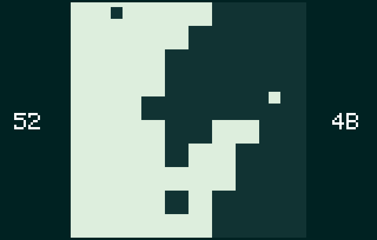

# Pong Wars for Atari Lynx

Self-playing game for Atari Lynx by [Neil Rackett](https://neilrackett.com/atarist)

## Introduction

The eternal battle between day and night, good and bad comes to the Atari Lynx!

Two balls bounce around a 10x10 board, each painting over the other's squares as it goes, while the score at either side keeps count. It's a port of [Pong Wars for Atari ST](https://github.com/neilrackett/atarist-pongwars), with the same speeds and bounces, in colours the Lynx can match far more closely than the ST could.

## Run

`pongwars.lnx` is available from the [releases](https://github.com/neilrackett/atarilynx-pongwars/releases) page. Play it in a Lynx emulator, on a real Lynx from a flash cartridge, or on your Atari ST with [MD/Lynx](https://github.com/neilrackett/md-lynx), which comes with it built in.

There's nothing to press: just sit back and watch.

## Build

1. Install [cc65](https://cc65.github.io) (`brew install cc65` on macOS, `sudo apt install cc65` on Linux) and Python 3
1. Open the command line and navigate to the project directory
1. Run `make` to compile the code
1. The cartridge image will be created in the `dist` folder

The splash screen is `src/splash.png`, a 160x102 PNG of up to 16 colours, which the build turns into a Lynx sprite.

## Credits

- Created by [Neil Rackett](https://x.com/neilrackett)
- Inspired by [Pong Wars by vnglst](https://github.com/vnglst/pong-wars)

## License

Released under [GNU General Public License v3.0](LICENSE)
